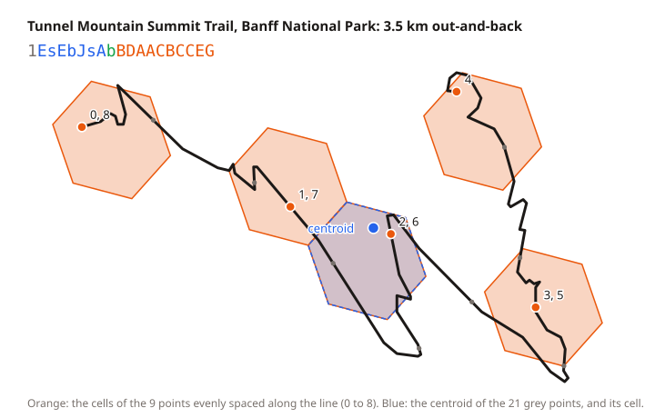
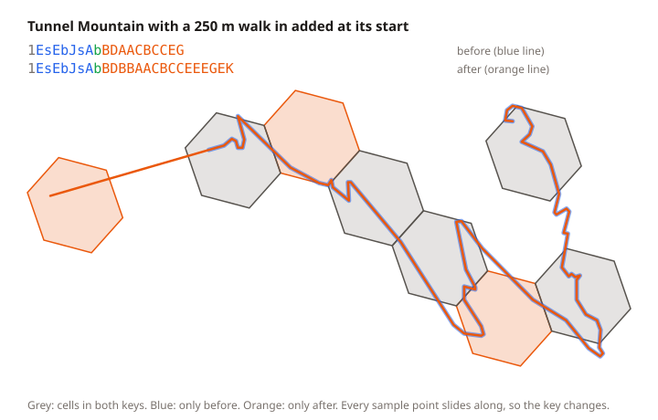
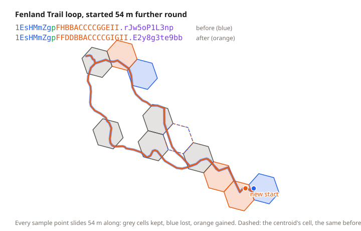

# route-keys

A route's identity, computed from its line.

```
routeKey(tunnelMountainSummitTrail, 'b')  →  "1EsEbJsAbBDAACBCCEG"
```

A route key is a short string (23 characters at the median) that anyone can
compute from a route's line, with no lookup table, and that anyone holding the
key can decode back to where the route is and roughly where it goes. This
repository is the canonical implementation, in TypeScript (`ts/`) and Python
(`python/`), with the written spec (`SPEC.md`) and the test vectors both
implementations are held to (`vectors/v1.json`).

## Why

[Hiker Atlas](https://www.hikeratlas.com) curates hikes from OpenStreetMap,
and rebuilds every one of them each build. Its routes have no permanent ids.
Minting ids would mean keeping a database that maps every build's routes back
to the ids before them, forever.

Meanwhile people want to point at routes durably: fave a hike, upload a GPS
track of it, review it. Those records live in people's own AT Protocol
accounts (hikeratlas/website#130), not in a database of ours. Other apps should
be able to read them without asking us what an id means.

A route key solves both. It's computed from the route's geometry, so:
- **No ids to mint or keep.** The same line gives the same key in every build, on every machine, in either language.
- **No table to keep.** A key decodes to its route's centroid and a coarse trace of its line, so a key whose route has changed can still be placed on a map and matched to nearby routes.
- **It's valid as a record key.** It uses base64url characters only, at most 45 characters on 59,256 real routes, so a fave's record key can be the route key itself.

## Anatomy of a key



`1EsEbJsAbBDAACBCCEG` is the Tunnel Mountain Summit Trail in Banff, a 3.5 km
out-and-back:

| Part | Characters | What it is |
|---|---|---|
| Version | `1` | recipe v1 |
| Centroid | `EsEbJsA` | the [H3](https://h3geo.org) cell (resolution 10, ~65 m across) containing the average of 21 points evenly spaced along the line: its 37 meaningful bits, so a key's prefix is a coarser area |
| Shape | `b` | `b` out-and-back, `p` loop, `w` one-way |
| Points | `BD` `AA` `CB` `CC` `EG` | the cells of 9 points evenly spaced along the line (0 to 8 above), as offsets from the centroid's cell in H3's local grid: (−1, −2), (0, 0), (1, −1), (1, 1), (2, 3). Distinct offsets, sorted, as zigzag varints |

An out-and-back's points come in pairs: going up and coming back down cross the
same cells. Its 9 points then make only 5 offsets, and the halfway point (4)
is its turnaround. SPEC.md has every detail.

## How keys behave

A key identifies a line, exactly. Change the line and the key may change, but
most of what it decodes to stays put. On the Tunnel Mountain trail:

| Change to the line | Key | Same key? | Centroid cell | Points' cells |
|---|---|---|---|---|
| (none) | `1EsEbJsAbBDAACBCCEG` | | | |
| Reversed (walked the other way) | `1EsEbJsAbBDAACBCCEG` | yes | same | all 5 the same |
| A point added mid-way along every segment | `1EsEbJsAbBDAACBCCEG` | yes | same | all 5 the same |
| Simplified (Douglas-Peucker, 20 m) | `1EsEbJsAbBDAACBCCEG` | yes | same | all 5 the same |
| Every point moved 3 m (one random draw) | `1EsEbJsAbBDAACBCCEG` | yes | same | all 5 the same |
| A 250 m walk in added at the start | `1EsEbJsAbBDBBAACBCCEEEGEK` | no | same | 5 of 5 kept, 3 new |
| Last 10% cut off | `1EsEbJsAbDDBDBBADCBCCEG` | no | same | 4 of 5 kept, 3 new |
| Called a one-way instead | `1EsEbJsAwBDAACBCCEG` | no | same | all 5 the same |



**Reversing a line never changes its key.** The point at 1/8 of the line is the
point at 7/8 of its reverse, and the points are kept as a set.

**Where a loop starts does matter.** The points are measured from the start.
On the Fenland Trail loop (2.7 km), `1EsHMmZgpFHBBACCCCGGEII`:

| Change | Key | Same key? | Centroid cell | Points' cells |
|---|---|---|---|---|
| Reversed | `1EsHMmZgpFHBBACCCCGGEII` | yes | same | all 7 the same |
| Started 1% of the way round | `1EsHMmZgpFFDDBBACCCCGGEII` | no | same | 6 of 7 kept, 2 new |
| Started 2% (54 m) of the way round | `1EsHMmZgpFFDDBBACCCCGIGII` | no | same | 5 of 7 kept, 3 new |
| Started an eighth of the way round | `1EsHMmZgpFHBBACCCCGGEII` | yes | same | all 7 the same |
| Started a quarter of the way round | `1EsHMmZApHJDDBAAAAEECGG` | no | moved | all 7 the same |



A start moved a whole eighth (or quarter) of the way round puts the points back
in the same places. A quarter turn still changed the key here, though: the
centroid averages 21 points, a loop's start counted twice, so moving the start
nudged it into the next cell, and every offset is measured from it.

**Small nudges change keys more often than you might expect.** A key holds 9
cells, and any one point near a cell's edge can tip it over. On 3,000 random
routes from Hiker Atlas (`scripts/corpus.py`):

| Every point of the line moved randomly by up to | Same key | Same centroid cell | Points' cells kept |
|---|---|---|---|
| 1 m | 88% | 100% | 99% |
| 3 m | 69% | 98% | 97% |
| 10 m | 32% | 95% | 87% |
| Simplified (Douglas-Peucker, 5 m) | 85% | 99% | 98% |
| A 250 m walk in added | 0% | 61% | 46% |

So use key equality for "the same line", such as a route unchanged since it
was faved. For "the same route, give or take", compare decoded cells. That's
how a fave of a route that's since moved a little can be matched to it.

## Traces

Keys are made for curated routes, whose lines are fixed by a build. A GPS
trace of someone hiking a route almost never has its exact key: an approach
from the car park, a side trip or GPS drift moves every point. To find which
routes a trace follows, test how many of each nearby route's decoded cells the
trace passes near. On 3,290 real traces crawled from hiking blogs (traces that
walk a curated route), ranking routes by "at least 7 of 9 points covered, then
the longest" put the right route in the top 5 99% of the time
(hikeratlas/website#130).

## Using it

TypeScript (`ts/`; depends on h3-js):

```ts
import { routeKey, decode, centroidOf, shapeFor } from '@hikeratlas/route-keys';

const key = routeKey(line, shapeFor('out-and-back'));   // line: [[lon, lat], ...]
decode(key);       // { version: '1', centroid: '8a12c11b26c7fff', shape: 'b', cells: [...] }
centroidOf(key);   // [lon, lat] of the centroid cell's centre, or null if not a key
```

Install a release's tarball (npm can't install a git dependency from a
subdirectory):

```json
"@hikeratlas/route-keys": "https://github.com/hikeratlas/route-keys/releases/download/v1.0.0/hikeratlas-route-keys-1.0.0.tgz"
```

Python (`python/`; depends on h3 4.x):

```python
from route_keys import route_key, decode, shape_for

key = route_key(line, shape_for('loop'))
decode(key).cells
```

```
pip install "route-keys @ git+https://github.com/hikeratlas/route-keys@v1.0.0#subdirectory=python"
```

## Stability

Keys are stored in people's records, so **recipe v1 never changes**:
- Both implementations are tested against `vectors/v1.json`: 22 real routes and 6 edge cases.
- The tests also check the vectors file's own hash.
- On all 59,256 routes of the build the vectors came from, the two implementations agree to the character.

Floating point is pinned down too: SPEC.md says which operations, in which order.

A better recipe would be v2, with a new version character, its own vectors,
and v1 still made and decoded as before. CLAUDE.md has the rules for anyone
(or any agent) changing this repository.

## Layout

| Path | |
|---|---|
| `SPEC.md` | recipe v1, normatively |
| `vectors/v1.json` | lines, their keys and decodings: the contract (frozen) |
| `ts/` | `@hikeratlas/route-keys`, TypeScript |
| `python/` | `route_keys`, Python |
| `scripts/examples.py` | this README's figures and tables, from `docs/examples.json` |
| `scripts/corpus.py` | the corpus table, from a routes file not in this repository |
| `scripts/make_vectors.py` | how `vectors/v1.json` was made (once) |

The example and vector lines are Hiker Atlas routes derived from OpenStreetMap
data, © OpenStreetMap contributors, available under the
[ODbL](https://opendatacommons.org/licenses/odbl/).
