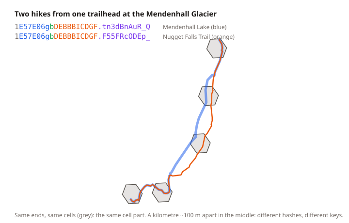

# route-keys

A route's identity, computed from its line.

```
routeKey(tunnelMountainSummitTrail, 'b')  →  "1EsEbJsAbBDAACBCCEG.31CoXYcAScA"
```

A route key is a string that anyone can compute from a route's line, with no
lookup table. Anyone holding a key can decode where the route is and roughly
where it goes. This repository is the canonical implementation, in
TypeScript (`ts/`) and Python (`python/`), with the written spec
(`SPEC.md`) and the test vectors both implementations are held to
(`vectors/v1.json`).

## Why

[Hiker Atlas](https://www.hikeratlas.com) curates hikes from OpenStreetMap,
and rebuilds every one of them each build. Its routes have no permanent ids.
Minting ids would mean keeping a database that maps every build's routes back
to the ids before them, forever.

Meanwhile people want to point at routes durably: fave a hike, upload a GPS
track of it, review it. Those records live in people's own AT Protocol
accounts (hikeratlas/website#130), not in a database of ours. Other apps should
be able to read them without asking us what an id means.

A route key solves both. It's computed from the route's line, so:
- **No ids to mint or keep.** The same line gives the same key in every build, on every machine, in either language.
- **No table to keep.** A key decodes to its route's location and a coarse trace of its line, so a key whose route has changed can still be placed on a map and matched to the routes curated now.
- **It's valid as a record key.** It uses base64url characters and a dot, at most 57 characters on 59,256 real routes, so a fave's record key can be the route key itself.

## Anatomy of a key


`1EsEbJsAbBDAACBCCEG.31CoXYcAScA` is the Tunnel Mountain Summit Trail in
Banff, a 3.5 km out-and-back:

| Part | Characters | What it is |
|---|---|---|
| Version | `1` | recipe v1 |
| Centroid | `EsEbJsA` | the [H3](https://h3geo.org) cell (resolution 10, ~65 m across) containing the average of 21 points evenly spaced along the line |
| Shape | `b` | `b` out-and-back, `p` loop, `w` one-way |
| Points | `BD` `AA` `CB` `CC` `EG` | the cells of 9 points evenly spaced along the line (0 to 8 above), as offsets from the centroid's cell: (−1, −2), (0, 0), (1, −1), (1, 1), (2, 3) |
| Hash | `.31CoXYcAScA` | 66 bits of a SHA-256 hash of the exact line, its coordinates rounded to 0.00001° |

- **Everything before the dot is the cell part.** It's coarse and decodable: where the route is, and roughly where it goes.
- **The hash makes the key exact.** Two different lines never share a key, even when their cells match.

An out-and-back's points come in pairs: going up and coming back down cross
the same cells. Its 9 points then make only 5 offsets, and the halfway point
(4) is its turnaround. SPEC.md has every detail.

## Two hikes, one cell part



At the Mendenhall Glacier near Juneau, two curated hikes leave the same
trailhead and turn around at the same point. For a kilometre in the middle
they take different paths, about 100 m apart.

Their cell parts are identical (`1E57E06gbDEBBBICDGF`), because every one of
their sample points falls in the same cells. Their hashes differ (`.tn3dBnAuR_Q`
and `.F55FRcODEp_`), so they're two keys. The cell part says they're in the same
place and nearly the same shape; the hash says they're different lines.

## How keys behave

Any change to a line gives it a new key, except writing it down with more
precision. The cell part usually survives small changes, and that's what
finds a route again after it changes. On the Tunnel Mountain trail:

| Change to the line | Key | Same key? | Same cell part? | Points' cells |
|---|---|---|---|---|
| (none) | `1EsEbJsAbBDAACBCCEG.31CoXYcAScA` | | | |
| Reversed (walked the other way) | `1EsEbJsAbBDAACBCCEG.31CoXYcAScA` | yes | yes | all 5 the same |
| Written with 7 decimals, plus float noise | `1EsEbJsAbBDAACBCCEG.31CoXYcAScA` | yes | yes | all 5 the same |
| A point added mid-way along every segment | `1EsEbJsAbBDAACBCCEG.eARLrr5hrFh` | no | yes | all 5 the same |
| Simplified (Douglas-Peucker, 20 m) | `1EsEbJsAbBDAACBCCEG.PB3BeCkMdVq` | no | yes | all 5 the same |
| Every point moved 3 m (one random draw) | `1EsEbJsAbBDAACBCCEG.aDv4YXWSLLa` | no | yes | all 5 the same |
| A 250 m walk in added at the start | `1EsEbJsAbBDBBAACBCCEEEGEK.HmaJeI0qfUp` | no | no | 5 of 5 kept, 3 new |
| Last 10% cut off | `1EsEbJsAbDDBDBBADCBCCEG.knHG1Q4zb5e` | no | no | 4 of 5 kept, 3 new |
| Called a one-way instead | `1EsEbJsAwBDAACBCCEG.31CoXYcAScA` | no | no | all 5 the same |


**Where a loop starts matters.** On the Fenland Trail loop (2.7 km),
`1EsHMmZgpFHBBACCCCGGEII.rJw5oP1L3np`:

| Change | Key | Same key? | Same cell part? | Points' cells |
|---|---|---|---|---|
| Reversed | `1EsHMmZgpFHBBACCCCGGEII.rJw5oP1L3np` | yes | yes | all 7 the same |
| Started 1% of the way round | `1EsHMmZgpFFDDBBACCCCGGEII.GSrpUgXff3L` | no | no | 6 of 7 kept, 2 new |
| Started 2% (54 m) of the way round | `1EsHMmZgpFFDDBBACCCCGIGII.E2y8g3te9bb` | no | no | 5 of 7 kept, 3 new |
| Started an eighth of the way round | `1EsHMmZgpFHBBACCCCGGEII.UaDoIRF1Wv0` | no | yes | all 7 the same |
| Started a quarter of the way round | `1EsHMmZApHJDDBAAAAEECGG.NABxwh-SxaV` | no | no | all 7 the same |


The points are measured from the start, so moving the start moves them.
Moving it a whole eighth puts the points back in the same places.
A quarter turn did that too, but the centroid averages 21 points with the
loop's start counted twice, so it moved into the next cell, and every offset
is measured from it.

On 3,000 random routes from Hiker Atlas (`scripts/corpus.py`):

| Change to every route | Same key | Same cell part | Points' cells kept |
|---|---|---|---|
| Written with 7 decimals, plus float noise | 100% | 100% | 100% |
| Every point moved by up to 1 m | 0% | 86% | 99% |
| Every point moved by up to 3 m | 0% | 69% | 97% |
| Every point moved by up to 10 m | 0% | 32% | 87% |
| Simplified (Douglas-Peucker, 5 m) | 1% | 85% | 98% |
| A 250 m walk in added | 0% | 0% | 46% |

**To find a route whose line has changed,** decode the old key's cells, and
score the routes near its centroid by how many of those cells their line
passes through. On 233 real changes between two of Hiker Atlas's builds
(trailheads moved, routes rerouted or extended), that picked the right route
87% of the time, tied it with others 9%, and got it wrong 4%.

## Traces

Keys are made for curated routes, whose lines a build fixes. A GPS trace of
someone hiking a route never has the route's key: an approach from the car
park, a side trip or GPS noise changes the line. To suggest which routes a
trace follows, test how many of each nearby route's decoded cells the trace
passes near. On 3,290 real traces crawled from hiking blogs, ranking routes
by "at least 7 of 9 points covered, then the longest" put the right route in
the top 5 99% of the time (hikeratlas/website#130).

## Design decisions

These were settled by measurement on Hiker Atlas's 59,256 curated routes
(13 November 2026), 233 real route changes between two builds, and 3,290
crawled GPS traces.

**Cells and a hash, not either alone.**
- **Cells alone** can't guarantee to tell apart routes that share both ends and differ by 100 m for a stretch. The Mendenhall hikes share all their cells, and so do some routes at any cell size and point count we tried.
- **A hash alone** distinguishes everything but means nothing on its own. Every lookup and every re-match would need an archive of past routes, kept forever.
- **The two together:** the hash makes the key exact, and the cell part keeps it meaningful without a lookup table.

Real changes between builds broke 94% of geometry-only keys anyway, so a key
that changes with any edit costs little.

**9 points at ~65 m.** We compared 3 to 25 points, at ~65 m, ~175 m and ~460 m
cells:
- **Re-matching a changed route** climbs steeply up to about 9 points (61% with 3, 85–87% with 9) and then flattens.
- **Coarser cells** keep the cell part through small nudges more often (with 13 points at ~175 m, 86% survive 3 m of jitter rather than 68%). They re-match slightly worse, and they don't help with real changes, which are too big for any cell size.
- **Since the hash now provides distinctness,** the cell part only has to locate and re-match, and 9 points at ~65 m does that best.

**Round coordinates to 0.00001°, nothing more.**
- **Rounding** makes a key independent of how a line was written down. Every Hiker Atlas line already sits on that grid, so for them rounding changes nothing.
- **Coarser rounding, simplification or resampling** can't make two edits of a trail match. Every such rule has thresholds where a vertex flips, and a line has hundreds of vertices. An edited trail is a real change: it gets a new key and is re-found by its cells.

**Direction isn't part of a key.**
- A key names the path on the ground, not which way it was walked: a loop clockwise or counter-clockwise, or a traverse from either end, has one key.
- People think of a loop as one hike, and its faves and reviews apply whichever way round. A track records its own direction in its GPX file.
- Where direction matters, a record can carry it beside the key.
- On the 13 November build, no two curated routes are the same path in opposite directions. Between it and the build before, no route's line came out reversed.

**Things that didn't help.**
- **Hysteresis, or "momentum" along the line:** only switch cells once well into the next one. This didn't change how often small nudges flip the cell part (68% kept at 3 m either way), and it made keys depend on direction.
- **Picking the most robust of several candidate keys,** for example the sampling whose points sit deepest inside their cells, made things worse (58% kept at 3 m). Which candidate wins is itself a threshold, and near-ties swap under small nudges.
- **Any rule that turns a continuous line into discrete cells has thresholds somewhere.** Only coarser cells or fewer points make them rarer.

**Collisions.**
- **The hash** only has to separate lines whose cell parts already match. On the 13 November build that's about 80 pairs, so at 66 bits the chance of any collision is around one in 10¹⁸.
- **Identical lines share a key on purpose.** On the 13 November build, 143 keys are each shared by the same line listed twice.
- **A build should still check its curated routes for shared keys.** Two different routes sharing a key would mean a bug; the same line curated twice means a duplicate to drop.

## Using it

TypeScript (`ts/`; depends on h3-js and @noble/hashes):

```ts
import { routeKey, decode, centroidOf, shapeFor } from '@hikeratlas/route-keys';

const key = routeKey(line, shapeFor('out-and-back'));   // line: [[lon, lat], ...]
decode(key);       // { version: '1', centroid: '8a12c11b26c7fff', shape: 'b', cells: [...], hash: '31CoXYcAScA' }
centroidOf(key);   // [lon, lat] of the centroid cell's centre, or null if not a key
```

Install a release's tarball (npm can't install a git dependency from a
subdirectory):

```json
"@hikeratlas/route-keys": "https://github.com/hikeratlas/route-keys/releases/download/v1.0.0/hikeratlas-route-keys-1.0.0.tgz"
```

Python (`python/`; depends on h3 4.x):

```python
from route_keys import route_key, decode, shape_for

key = route_key(line, shape_for('loop'))
decode(key).cells
```

```
pip install "route-keys @ git+https://github.com/hikeratlas/route-keys@v1.0.0#subdirectory=python"
```

## Stability

Keys are stored in people's records, so **recipe v1 never changes**:
- Both implementations are tested against `vectors/v1.json`: 22 real routes, the two Mendenhall hikes, and 7 edge cases.
- The tests also check the vectors file's own hash.
- On all 59,256 routes of the build the vectors came from, the two implementations agree to the character.

Floating point is pinned down: SPEC.md says which operations, in which order.

A better recipe would be v2, with a new version character, its own vectors,
and v1 still made and decoded as before. CLAUDE.md has the rules for anyone
(or any agent) changing this repository.

## Layout

| Path | |
|---|---|
| `SPEC.md` | recipe v1, normatively |
| `vectors/v1.json` | lines, their keys and decodings: the contract (frozen) |
| `ts/` | `@hikeratlas/route-keys`, TypeScript |
| `python/` | `route_keys`, Python |
| `scripts/examples.py` | this README's figures and tables, from `docs/examples.json` |
| `scripts/corpus.py` | the corpus table, from a routes file not in this repository |
| `scripts/make_vectors.py` | how `vectors/v1.json` was made (once) |

The example and vector lines are Hiker Atlas routes derived from OpenStreetMap
data, © OpenStreetMap contributors, available under the
[ODbL](https://opendatacommons.org/licenses/odbl/).
